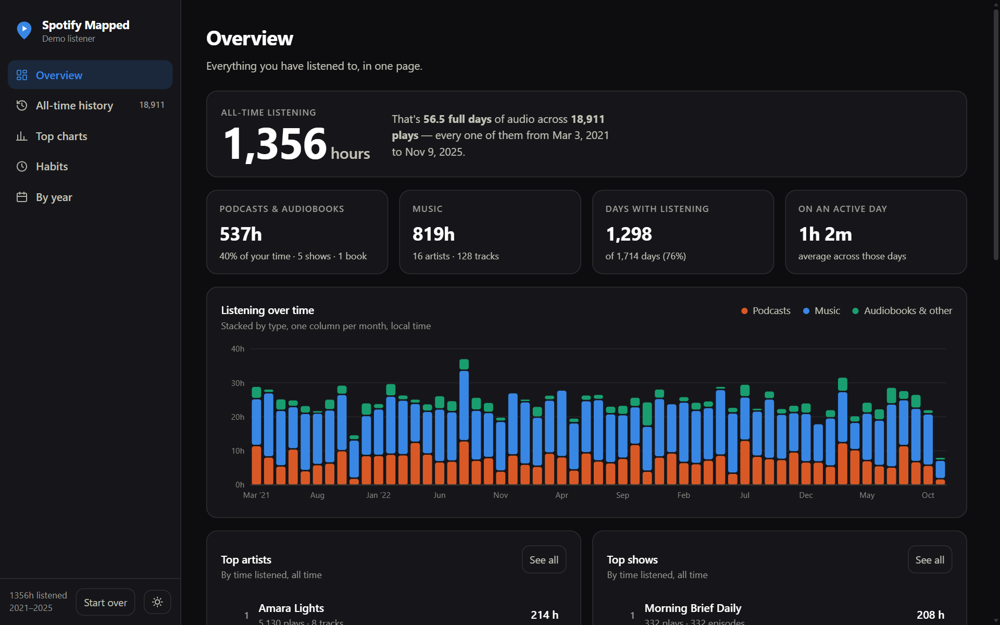
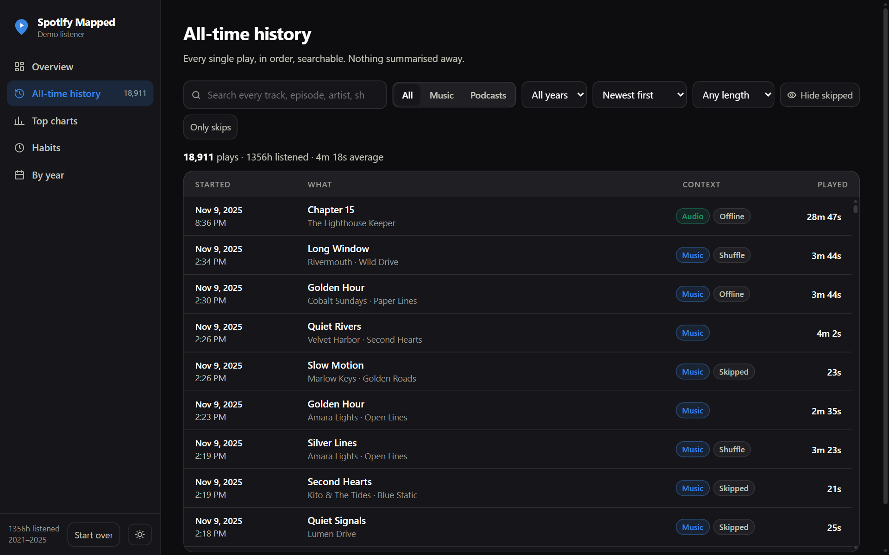
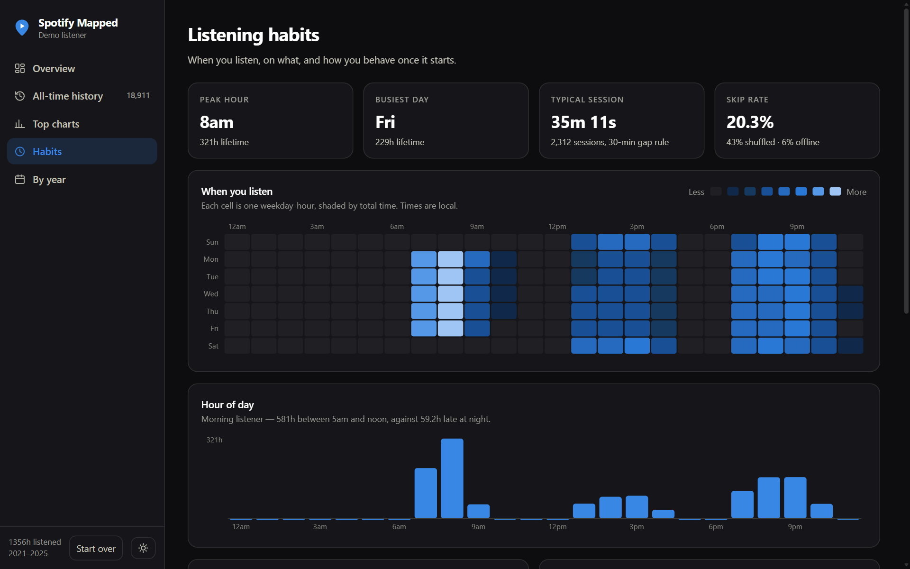
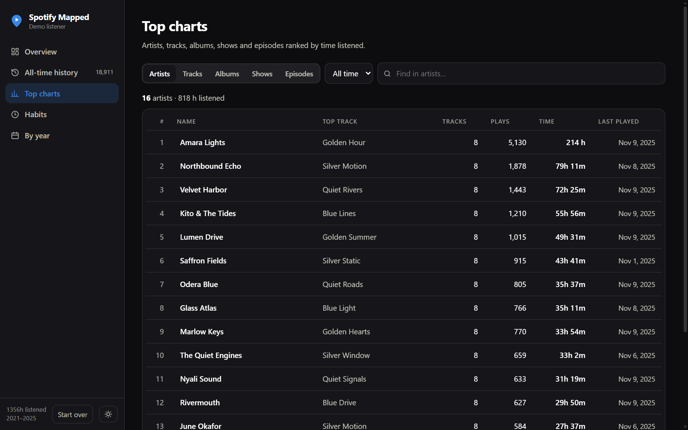
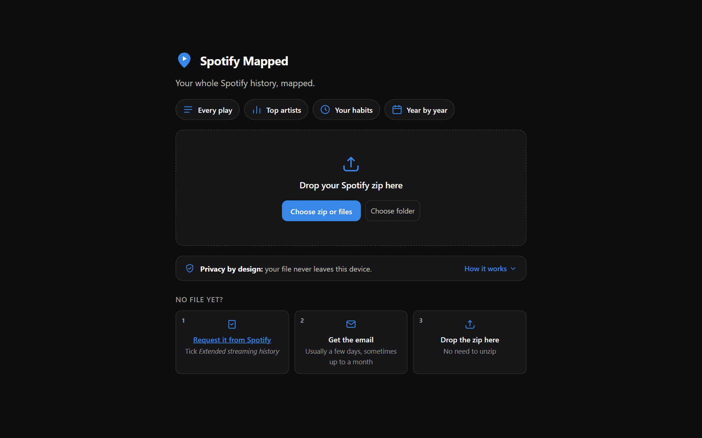

# Spotify Mapped

See your complete Spotify listening history, every play since you joined, from the
data export Spotify gives you.

<h2 align="center">
  <a href="https://isaacmwaura.github.io/spotify-mapped/">&#9654;&nbsp; Open Spotify Mapped</a>
</h2>
<p align="center">
  <a href="https://isaacmwaura.github.io/spotify-mapped/"><b>isaacmwaura.github.io/spotify-mapped</b></a><br>
  This is the only official address. The tool runs there, in your browser.<br>
  It never asks you to sign in to Spotify, Google or anything else.
</p>

<p align="center">
  <a href="https://isaacmwaura.github.io/spotify-mapped/"></a>
</p>

**Private by design.** Your file is read inside your browser tab. Nothing is uploaded,
because there is no server, and it keeps working offline once the page has loaded.
Nothing is saved: close or reload the tab and the data is gone.

This is an independent project. It is not made by, or affiliated with, Spotify.
The pictures on this page use an invented listener, not anyone's real data.

## Using it

1. **Request your data from Spotify.** Go to your account's privacy settings
   (`spotify.com/account/privacy`) and request **Extended streaming history**. The
   default "Account data" option only covers about the last year; the extended one goes
   back to the day you joined. You can request both.
2. **Wait for the email.** Spotify sends a download link when the export is ready. This
   usually takes a few days, and sometimes up to a month.
3. **Open [Spotify Mapped](https://isaacmwaura.github.io/spotify-mapped/) and add the file.** On a computer, drag the zip onto the page, or
   choose it. On a phone, tap *Choose file* and pick the zip. You can also choose the
   unzipped folder on a computer.

The app reads the files it needs and ignores the rest. A full export includes tens of
megabytes of technical logs that say nothing about your listening; those are never even
unpacked.

### Phones

It works in a phone's browser. Two limits worth knowing:

- Phones cannot pick a whole folder, so choose the zip itself.
- Unpacking needs the whole zip in memory. A very large export can be too much for a
  phone. If that happens, the app says so: unzip it on a computer and choose just the
  *Spotify Extended Streaming History* folder, which is only a few megabytes.

## What it shows

| Screen | What it answers |
|---|---|
| **Overview** | How much, since when, music versus podcasts, top artists and shows, and moments such as your first play, heaviest day and longest unbroken session |
| **All-time history** | Every play, each with its own start date and time. Search titles, artists, shows and albums. Filter by type, year, length, and whether it was skipped |
| **Top charts** | Artists, tracks, albums, shows and episodes ranked by time listened, for all time or one year |
| **Habits** | When you listen (a weekday-by-hour heat map), on what devices, and how plays start and end |
| **By year** | A summary of every year side by side |

Click any artist or show to see your history with them.

<table>
  <tr>
    <td width="50%"><br><b>All-time history.</b> Every play, searchable, with skips marked.</td>
    <td width="50%"><br><b>Habits.</b> When you listen, hour by hour.</td>
  </tr>
  <tr>
    <td width="50%"><br><b>Top charts.</b> Ranked by time listened, all time or one year.</td>
    <td width="50%"><br><b>Start screen.</b> Add the zip Spotify emails you.</td>
  </tr>
</table>

## How the numbers are worked out

- **Times are when you pressed play.** Spotify records only when a play *stopped*. The
  app works out the start by taking away the time played. A long play is counted in
  every hour it covered, so a 90-minute episode adds to three hours of the heat map, not one.
- **Rankings use time listened, not play count.** A three-second skip and a full album
  are not the same, so time is the fairer measure. The one exception is "most played
  tracks", which counts plays because that is what it promises.
- **"Skipped" is Spotify's own marker.** It means a play ended before the end of the
  item, including a long podcast paused for the night. It does not mean you disliked it.
- **Times are shown in your device's time zone.** Plays made while travelling appear in
  the time zone of the device you are viewing on, not the one you were in.
- **Duplicates are removed.** Spotify's export can contain the same history more than
  once. A play counts once however many times it appears.
- **Genre is not available.** Spotify's export does not include the genre of a song or
  artist, and the app does not look anything up online.

## Running it yourself

You need [Node.js](https://nodejs.org/) 20 or newer.

```bash
npm install
npm run dev
```

Then open the address it prints.

| Command | What it does |
|---|---|
| `npm run dev` | Runs the app locally and reloads it as you edit |
| `npm test` | Runs the automated tests |
| `npm run build` | Builds the app as three files in `dist/` |
| `npm run build:single` | Builds the whole app as one file, `dist-single/index.html` |

The built app must be opened through a web server, even a local one such as
`npx serve dist-single`. Browsers refuse to run it when the file is opened straight from disk.

## Tests

`npm test` runs the checks in `tests/`. They use made-up Spotify exports that cover
situations one person's data rarely does: other years (2015 to 2027), music only,
podcasts only, audiobooks, the older basic export format, a single play, nearly 60,000
plays, duplicate copies, damaged files, and the zip itself. They also confirm that no
personal details are kept, that nothing is saved between visits, and that the app has
no code that sends anything over the internet.

## Publishing

`.github/workflows/deploy.yml` runs the tests, builds the one-file app and publishes it
to GitHub Pages whenever `main` changes. If any test fails, nothing is published.

To switch it on: **Settings → Pages → Source: GitHub Actions**.

## How it is built

```
src/lib/ingest.ts     reads the export: finds the right files, removes duplicates,
                      keeps only what is shown
src/lib/unpack.ts     unzips the export, skipping files it does not need
src/lib/data.ts       turns the packed data into plays, with start and stop times
src/lib/stats.ts      every total, ranking, chart and session
src/lib/route.ts      which screen to show, with a safe fallback
src/components/       charts, the history list, the artist panel, the crash screen
src/views/            the import screen and the five screens
tests/                automated tests and the made-up exports they use
```

Three packages run in the browser: **React** and **React DOM** draw the screens, and **fflate** opens the
zip. Everything else is a build or test tool that never reaches the browser. The charts,
the history list and the styling are written for this project, without a chart library
or design kit.

## Licence

MIT. See [LICENSE](LICENSE). You may use, change and share the code, as long as
the licence notice stays with it.

Spotify is a trademark owned by Spotify. The name is used here only to say which export the app reads.
